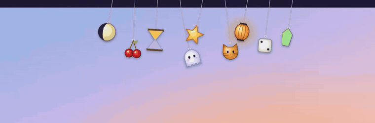
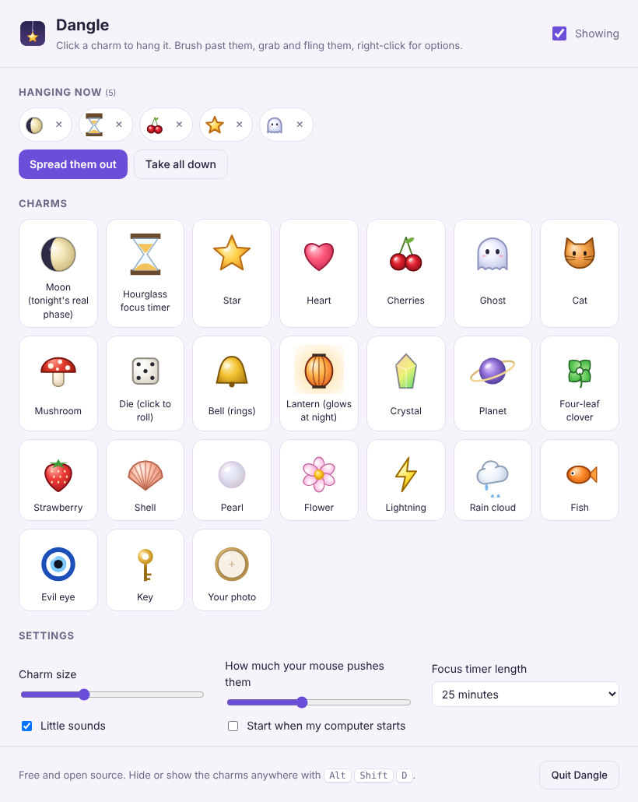

<div align="center">


# Dangle

**Little charms that hang from the top of your screen.**
They swing when you brush past them, you can grab and fling them, and the hourglass is a focus timer.
Free and open source. No account, no ads, no paywall.

Windows · macOS · Linux



[Demo video (MP4)](docs/demo.mp4) · [Install](#install) · [Charms](#charms) · [Compared to paid charm apps](#compared-to-paid-charm-apps)

</div>

---

## Install

**Windows** (PowerShell, installs for your user only, no admin needed):

```powershell
irm https://raw.githubusercontent.com/llamaboi55/dangle/main/scripts/install.ps1 | iex
```

**macOS and Linux:**

```sh
curl -fsSL https://raw.githubusercontent.com/llamaboi55/dangle/main/scripts/install.sh | sh
```

Both commands download the latest release straight from GitHub and install it. Files fetched this way don't get flagged, so there's no "unknown publisher" warning to click through. Run the same command again to update. You can also download the installer for your system from [Releases](https://github.com/llamaboi55/dangle/releases/latest).

**Build it yourself** (needs [Rust](https://rustup.rs) and Node.js 18+; on Linux also the [Tauri packages](https://tauri.app/start/prerequisites/)):

```sh
git clone https://github.com/llamaboi55/dangle && cd dangle && npm install && npm run build
```

**Just look at it** (no install): `npm run preview`, then open the printed address.

## How it works

- Charms hang on real rope physics. Move your mouse past them and they sway, bump into each other and clink.
- **Grab** a charm to drag it around and **let go** to fling it.
- **Click** a charm for a little bounce. The die rolls, the bell rings, and the lantern lights up.
- **Right-click** a charm to change its string length, remove it, or open the shelf.
- **Hourglass focus timer:** click it to start a focus session (25 minutes by default). The sand drains as time passes, and it chimes and bounces when you're done. Hover over it to see the time left. Right-click it for 15, 25 or 50 minutes.
- **The shelf** (click the tray icon) is where you pick charms, add a charm made from your own photo, and change the size, sway strength, sounds and start-at-login.
- **Alt Shift D** hides or shows all charms from anywhere, for screen sharing or full-screen video.
- Everywhere except the charms themselves, clicks go straight through to the apps underneath.
- When nothing moves, Dangle stops animating, so it uses next to no CPU while idle.

## Charms

24 original charms, all drawn in code: a **moon that shows tonight's real moon phase**, an hourglass focus timer, star, heart, cherries, a ghost that blinks, a cat, mushroom, a die you can roll, a bell that rings, a lantern that glows after dark, a color-shifting crystal, a planet, a four-leaf clover, a strawberry, a shell, a pearl, a flower, lightning, a rain cloud, a fish, an evil eye, a key, and **your own photo**.



## Compared to paid charm apps

| | Dangle | Typical paid menu bar charm app |
|---|---|---|
| Price | Free | Paid |
| Windows and Linux | ✅ | ❌ Mac only |
| Physics: sway, grab and fling, collisions | ✅ | ✅ |
| Focus timer charm | ✅ | ✅ |
| Photo charm from your own picture | ✅ | ✅ |
| Real moon phase | ✅ | ❌ |
| Open source | ✅ | ❌ |
| Account or tracking | None | Varies |

## Privacy

Dangle makes no network requests at all. Your charms and settings stay on your computer, in the app's own storage. Photo charms are shrunk to a small image and kept there too.

## Good to know

- On Linux, transparent windows need a compositor. GNOME, KDE, Cinnamon, Xfce with compositing turned on, and most other modern desktops have one. On Wayland, clicking through the empty space between charms depends on your desktop's support.
- On macOS, the charms hang just under the menu bar.

## Development

```sh
npm install
npm run preview      # browser preview with no Rust build, for working on the charms and physics
npm run dev          # the real app with hot reload
npm test             # physics tests (node --test) and Rust tests
```

- `src/js/physics.js`: rope physics (Verlet integration, slack ropes, collisions)
- `src/js/art.js`: every charm's drawing code
- `src/js/strip.js`: the transparent strip with the animation loop, mouse pass-through and the focus timer
- `src/js/shelf.js`: the shelf window
- `src-tauri/src/lib.rs`: window placement, cursor tracking, tray and the global shortcut

Releases are built for all three systems by GitHub Actions whenever the version in `src-tauri/tauri.conf.json` changes on `main`.

## License

MIT. Dangle is an independent project and isn't affiliated with any other charm app.
